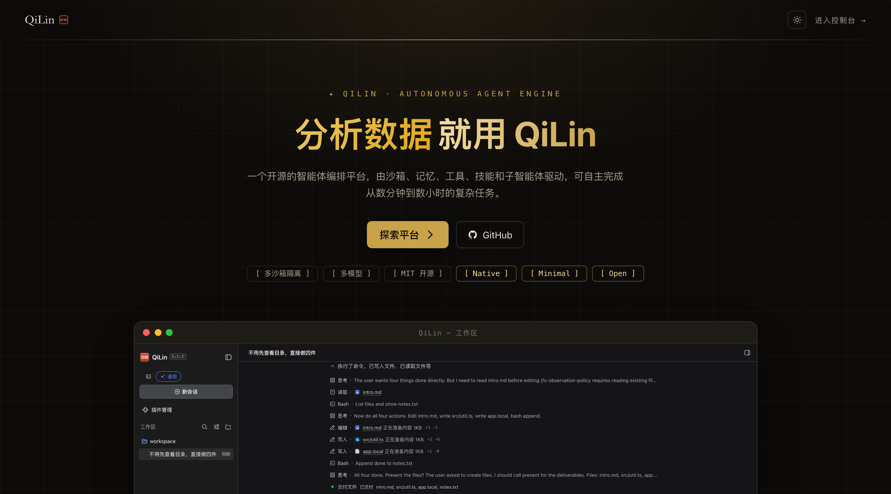

# QiLin

[English](README.md) | 中文

QiLin（`qilin`）是一个开源的 agent harness（智能体框架）。agent 在可持久化的会话中工作：读写与编辑文件、执行 shell 命令和持久终端、搜索网络、查询语言服务器，并把工作委派给 subagent 与后台任务；所有模型可见的输入与输出都记录到可重放的会话日志中。

它构建于**一切皆插件**的架构之上，由 [Cordis](https://github.com/cordiverse/cordis) 驱动；Cordis 源码以 vendor 方式收入本仓库并更名为 Kylin（见 [vendor/README.md](vendor/README.md)），其设计参见论文 [_A Programming Paradigm for Spatiotemporal Composability_](https://arxiv.org/abs/2608.25512)。模型适配器、工具注册表、会话日志以及 agent loop（智能体循环）本身都是插件，每一个都可以从配置中替换。



文档：[用户指南](docs/user/index.zh.md)、[开发指南](docs/development.zh.md)与[架构文档](docs/architecture.zh.md)。

## 产品理念

QiLin 是遵循 [NMO 产品理念](docs/nmo.zh.md) 的产品线的锚：**Native** 让 agent、会话、领域与插件的事实由自己的运行时持有；**Minimal** 让用户操作收敛到任务允许的最少步骤，打断只发生在真实决策点；**Open** 让生态经公开契约进入。QiLin 上的产品在开发前逐一写明如何遵循三条；设计争议以三条仲裁。

## 开发者预览

QiLin 处于 _开发者预览_ 阶段，正在快速迭代。**未来将出现破坏兼容性的变更。**

运行本项目前，请阅读[安全说明](SAFETY.zh.md)。

## 架构


图中每条连接都有流动的数据包，配色跟随读者的浅色或深色偏好。可配合[架构文档](docs/architecture.zh.md)阅读。

### 两种部署形态

同一套基座以两种形态交付，差异是有意为之：

**Web——多租户。** `qilin web` 为多个账户服务同一个入口。supervisor（hub）维护账户名册，并按需为**每个账户启动一个隔离的运行时**；会话、工作区、用量账本、插件与模型设置都归属各自的租户。浏览器通过部署自己的门（`/login`、`/setup`、`/api/auth`）认证，由会话命名的路由 cookie 被转发到所属账户的运行时，也可通过 `/t/<账户>/` 显式进入任一账户。自助注册是一项部署策略（`--registration open|closed`，环回之外默认关闭）。一名管理员席位可读取部署范围的用量账本。TLS 由 hub 以 `--tls-cert/--tls-key` 终结；`--per-account-ports` 可让每个账户使用独立 origin，替代共享地址。

**桌面——单用户。** [桌面壳](apps/desktop/README.zh.md)把一个本地引擎包进一个窗口，服务于一个人：没有名册、没有账户门、没有租户路由——整套基座在本地对着一个数据目录运行，插件树、会话与工具与 Web 形态完全一致。

## 能力

**入口模式。** [`qilin` CLI（命令行界面）](apps/cli/README.zh.md)通过具名 profile 从同一棵插件树启动所有模式：

- `qilin web` —— 浏览器 GUI：会话与聊天、模型配置、插件与设置管理、文件预览、终端以及会话历史。
- `qilin --profile headless "task"` —— 一次性持久化运行，打印最终回答后退出。
- `qilin --profile sdk` 与 `qilin --profile sdk-minimal` —— 由 [TypeScript](packages/sdk/README.zh.md) 与 [Python](python/README.zh.md) SDK 驱动的 JSON-RPC 服务器。
- `qilin --profile acp` —— 面向自动化客户端的 ACP（Agent Client Protocol）服务器。

**工具与执行。** 工具集覆盖一次性与持久 PTY 两种形式的 bash 与 PowerShell、文件读写编辑与图片读取、基于内置 ripgrep 的 glob/grep 发现、LSP 查询、网络搜索与抓取、skill（技能）、todo/plan/goal 跟踪以及向用户提问的 ask-user 交互。工作可委派给后台任务、支持模型选择与中途引导的 subagent、脚本化多 agent 工作流或定时跟进；会话支持 fork、恢复与全文检索。自动生成的[工具目录](docs/tool-catalog.zh.md)列出了全部面向模型的工具。

**模型。** DeepSeek 适配器与多提供方 `pi-ai` 适配器覆盖 Anthropic、OpenAI、Kimi、GLM 等内置提供方，以及自定义的 OpenAI 或 Anthropic 兼容网关；参见[配置模型](docs/user/guide/providers.zh.md)。

**执行世界与沙箱。** 文件系统、子进程与沙箱 provider 构成一个可替换的执行世界：默认本机、经成对 provider 的 SSH 远程主机、以及 bwrap/Landlock/Seatbelt 后端的进程隔离。实验包通过注册 provider 提供浏览器与电脑交互。

**一切皆插件。** profile 在你自己的 `cordis.patch.yml` 之下堆叠可打补丁的 bundle 层；`qilin plugin` 与 Web 插件管理器安装、启停、移除插件；外部 MCP 服务器挂载为原生工具；既有 Claude Code 与 Codex 的 shell 钩子无需修改即可运行；经验证的 webhook 从外部事件启动会话。从[第一个插件](docs/user/develop/basic/index.zh.md)、[架构文档](docs/architecture.zh.md)与[包地图](packages/README.zh.md)开始。

## 运行

### 运行桌面应用

[桌面壳](apps/desktop/README.zh.md)在一个窗口内启动本地引擎与工作台。数据都在一个本地目录下；不共享、不路由。

### 运行 Web 部署

从仓库检出运行：

```sh
git clone https://github.com/kkutysllb/QiLin.git
cd QiLin
pnpm install
pnpm run build
pnpm qilin web
```

`pnpm run build` 准备仓库产物；`pnpm qilin web` 直接使用这些产物而不重新构建。服务默认起在 `http://127.0.0.1:8790`；传 `--no-open` 则不打开浏览器。见 [Web UI 指南](docs/user/guide/index.zh.md)。

首次浏览器访问会通过产品自己的初始化表单创建第一个账户。要让一个部署服务多人，添加账户即可（环回之外的部署会自动关闭自助注册）：

```sh
printf 'password
' | npx qilin tenants add alice --password-stdin
npx qilin web --port 8790 --no-open --max-tenants 0
```

每个账户都在自己的运行时里工作，拥有自己的会话、工作区、用量账本与设置。部署的管理员（`tenants add <name> --admin` 创建）读取部署范围的用量报告；其他账户只能读自己的。注册策略、TLS、每账户独立 origin 与多账户浏览器边界见[租户指南](docs/user/guide/tenancy.zh.md)。

## 参与贡献

见 [CONTRIBUTING.zh.md](CONTRIBUTING.zh.md)。

## 开发

从[开发指南](docs/development.zh.md)与[架构文档](docs/architecture.zh.md)开始。

对智能体，遵循 [AGENTS.md](AGENTS.md)。

## 许可证

[MIT](LICENSE)

第三方依赖及其许可证在 [THIRD_PARTY_NOTICES.md](THIRD_PARTY_NOTICES.md) 披露。
